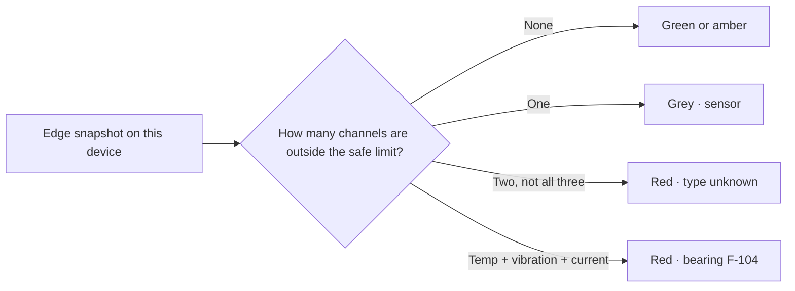

<p align="center">
  <a href="app/index.html"></a>
  
  
  
</p>

<h1 align="center">EdgeCare</h1>
<p align="center">
  <strong>Predict. Prevent. Perform.</strong><br>
  Plug-and-Learn maintenance for an Indian MSME shop floor.<br>
  The internet can be down. The owner still gets the call.
</p>

<p align="center">
  Tech4Bharat Hackathon 2026 · Problem statement 4.3 · Cognivista
</p>

---

## The bill on one seized spindle

A CNC lathe in Bay B does not fail quietly. It fails in rupees.

| | |
|---|---:|
| Downtime if you wait | **₹31,700** |
| The bearing, at Sri Murugan Spares, 1.2 km away | **₹540** |
| Karthik Raja, 1.4 km, about 5 minutes | **₹350** |
| Repair | **₹890** |
| Kept on the floor | **₹30,810** |

Fault **F-104**. Part **SKF 6205-2RS**. Node **ESP32-NODE-01**.

That is the pitch example, stored on the device. Other shops and the other two machines are labelled demo. Nothing here pretends to be a live plant feed.

---

## Open it in thirty seconds

There is no install, no account, and no build.

```bash
git clone https://github.com/8cvishnupriya-hash/Tech4Bharat.git
cd Tech4Bharat
python -m http.server 8080
```

Then open [http://127.0.0.1:8080/app/](http://127.0.0.1:8080/app/).

`app/index.html` also opens straight from the folder. Classic scripts, so `file://` works.

> The `index.html` at the repository root is a saved Gemini page. **The app is `app/`.**

### One minute on the floor

1. Land on **M-01 · CNC Lathe #02**. State is **Normal Healthy**.
2. Switch State to **Machine Fault**. The colour goes red. The rupees appear for real.
3. Open diagnostics. Temperature, vibration, and current rose together. That is bearing wear, not a loose sensor.
4. Press **1** on the 2G keypad. An SMS is queued on this device: delivery from Sri Murugan Spares.
5. Switch language. English, हिन्दी, தமிழ், తెలుగు. The verdict does not change. The words do.
6. **New machine**. Type a nameplate. 15 kW, 1440 rpm, IE3 matches frame 160L on the on-device catalog. Confirm it on the metal plate.

---

## Three machines, six doors

```text
┌─────────────────────────────────────────────────────────────┐
│  Tech4Bharat          EdgeCare Offline            English  │
│                                                             │
│  ( M-01 Lathe )   ( M-02 Press )   ( M-03 Compressor )     │
│                                          STATE ▾            │
│  ● All Systems Operational                                  │
│                                                             │
│  [ Open Diagnostics ]    [ Listen in Local Language ]       │
│                                                             │
│  ┌────────────┐  ┌────────────┐  ┌────────────┐            │
│  │ Diagnostics│  │  2G  IVR   │  │   Spares   │            │
│  ├────────────┤  ├────────────┤  ├────────────┤            │
│  │ Mechanics  │  │  Downtime  │  │   Ledger   │            │
│  └────────────┘  └────────────┘  └────────────┘            │
└─────────────────────────────────────────────────────────────┘
```

| Machine | What the floor should do |
|---|---|
| **M-01 CNC Lathe #02** | Healthy, or a red bearing fault. Stop only on red. The owner approves the repair. |
| **M-02 Hydraulic Press #04** | Sensors are inside their limits. Lubrication PM is 1 day overdue. Plan the idle window. Do not invent a downtime bill. |
| **M-03 Industrial Compressor #01** | Only vibration is bad. Check the MPU-6050. Do not stop the machine. |

| Door | What you get |
|---|---|
| Diagnostics | Safe limit, this machine's own baseline, and a cross-check across the three channels |
| Owner 2G phone | Keys **1** deliver, **2** pick up, **3** repeat. Anything else is a hint, not a command |
| Local spares | Three shops. The lathe's ₹540 is the pitch price. The rest say demo |
| Nearby mechanics | Karthik Raja, Yusuf Khan, Meena Engineering. Assigning one recalculates the repair |
| Downtime vs repair | The ₹31,700 bar against the ₹890 bar, plus a payback form you fill yourself |
| Views and ledger | Front, back, top, factory floor, and the notes kept on this device |

---

## How a colour is earned

The colour comes from absolute safe limits. A profile switch (1440 rpm loaded against 1200 rpm light) changes the deltas and can warn you that the baselines do not match. It does not repaint the verdict.

| Colour | Rule | Action |
|---|---|---|
| Green | Every channel inside its limit | No dispatch |
| Amber | Still inside the limits, and a PM is overdue or the trend is worsening | Plan the idle window |
| Red | Two or more channels outside their limits | Stop and inspect |
| Red, bearing | Temperature, vibration, **and** current are all bad | Spindle bearing. Not a sensor |
| Grey | Exactly one channel is bad | Check that sensor. Leave the machine running |



---

## What stays on the phone

- Vanilla HTML, CSS, and JavaScript. No framework, no bundler, no server required.
- Memory is `localStorage`, key `edgecare-v1`.
- Speech uses the browser voice: `en-IN`, `hi-IN`, `ta-IN`, `te-IN`.
- Indic text uses Segoe UI and Nirmala UI. The page does not call out for a font.
- Routes are hashes: `#/m01`, `#/m01/diagnostics`, `#/m01/ivr`, `#/nameplate`. Escape walks home.
- The nameplate catalog is a demo table on the device, not a live OEM feed.
- Clamp-on kit in the pitch: vibration MPU-6050, current ACS712, temperature PT100, edge ESP32. Industrial stand-ins are named in the app. There is no invented kit price.

---

## What is in this repo

| Path | Keep it because |
|---|---|
| [`app/`](app/) | The working EdgeCare app. Start at [`app/index.html`](app/index.html) |
| [`Tech4bharat ppt.pdf`](Tech4bharat%20ppt.pdf) | The pitch slides |
| [`Plug-and-Learn_Pitch_Video (online-video-cutter.com).mp4`](<Plug-and-Learn_Pitch_Video%20(online-video-cutter.com).mp4>) | The pitch film |
| [`index.html`](index.html) | A saved Gemini shell. Not the product |

```text
app/
  index.html    the page
  styles.css    the floor, in navy and saffron-orange
  app.js        screens, keypad, speech, routes
  data.js       the three machines, shops, mechanics, catalog
  logic.js      colour, rupees, payback, nameplate match
  i18n.js       English, Hindi, Tamil, Telugu
```

Payback, when you type your own numbers:

**months = kit cost / (downtime avoided each month − monthly fee)**

Try 4500, 10000, and 500. The app answers about **0.5 months**. Empty fields stay empty on purpose.
